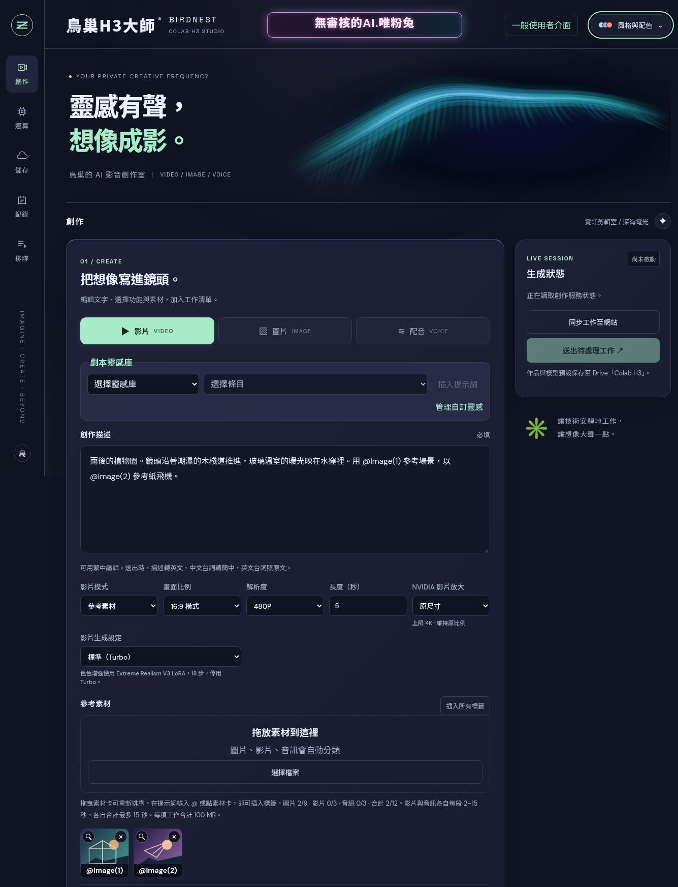

# Birdnest H3 Studio

[繁體中文](README.md) · **English**

Birdnest H3 Studio is a browser-based workspace for MiniMax H3. Creators assemble prompts and reference assets, and an administrator connects a Google Colab GPU to run jobs with ComfyUI and H3 Toybox.



## Features

- **Video, images and voice** with text-to-video, first/last-frame conditioning and image, video or audio references.
- **Reference cards** with 96 × 96 px thumbnails, large previews and drag-to-reorder. Prompt mentions are renumbered automatically and stay bound to the same assets.
- **Prompt language handling** that keeps the Traditional Chinese draft and sends English scene descriptions with Simplified Chinese dialogue. English dialogue is preserved.
- **GPU management** with Colab allocation and Drive mount status, run-time limits and idle shutdown.
- **Job history and prompt library** with generation progress and editable presets. This edition ships with two original examples.

## Local development

Use Node.js 22.13 or later, npm and Python 3. Run these commands from the repository root.

```bash
git clone https://github.com/josefhsu/birdnest-h3-studio.git
cd birdnest-h3-studio
npm ci
npm run build
for migration in drizzle/*.sql; do
  npx wrangler d1 execute DB --local --config dist/server/wrangler.json \
    --persist-to .wrangler/state --file "$migration"
done
cp .dev.vars.example .dev.vars
npm run dev
```

Open the URL printed by the dev server. Apply the migrations once, in filename order, to a new local database. Loopback development supports mock sign-in at `/signin-with-chatgpt?return_to=/admin`. The administrator workspace still requires verification with the configured Google account. The build and automated tests run without a GPU, Google OAuth credentials or a Drive account.

## Deployment

The production setup expects the **OpenAI Sites** authentication gateway and Cloudflare Worker resources. Create your own Sites project, bind D1 as `DB` and R2 as `BUCKET`, then apply the SQL files in `drizzle/` to that D1 in order. The exported .openai/hosting.json declares binding names. Set your own project ID when publishing to Sites.

| Variable | Purpose |
| --- | --- |
| `ADMIN_GOOGLE_EMAIL` | The Google email allowed to complete administrator verification |
| `COLAB_OAUTH_CONFIG` | Your Colab-compatible OAuth client JSON, wrapped as `installed` or `web` |
| `COLAB_ENCRYPTION_KEY` | A random 32-byte key encoded in standard Base64, for example from `openssl rand -base64 32` |
| `CREATOR_USERNAME` | Creator sign-in name. Defaults to `creator` |
| `CREATOR_SHARED_PASSWORD` | Creator sign-in password. Use a long random value |
| `TRUST_SITES_IDENTITY` | Enable only behind a Sites gateway that authenticates requests and overwrites `oai-authenticated-user-*`. Leave disabled on a directly exposed Worker |

The app uses a Colab CLI-compatible OAuth flow. The operator supplies a client compatible with the required flow and scopes, plus access to Colab GPUs and Drive. Verify the Google account at `/admin`, then open Compute to start a GPU and mount Drive. Creators sign in at `/creator`. Allocation depends on account eligibility, quota and current capacity. Setup, model downloads and inference can consume Colab compute units.

## Checks

```bash
npx tsc --noEmit
node --experimental-vm-modules --test tests/colab-controller.test.mjs
python3 tests/test_watchdog.py
```

## License and credits

Original application code and documentation use the [MIT License](LICENSE). Third-party code, models and LoRAs retain their own licenses. This source snapshot includes sample data. It excludes production databases, media, credentials and the original prompt asset packs. See [third-party notices](THIRD_PARTY_NOTICES.md).

Thanks to [dseditor / DSLab](https://github.com/dseditor) for sharing the H3 Colab workflow and H3 Toybox.
